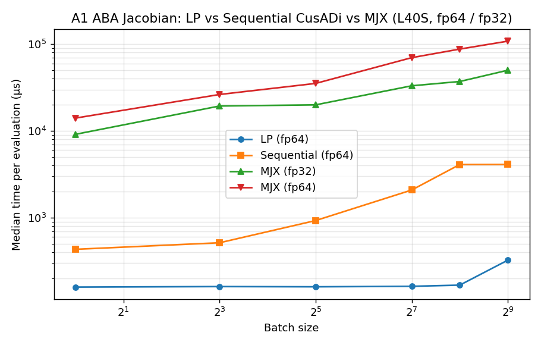
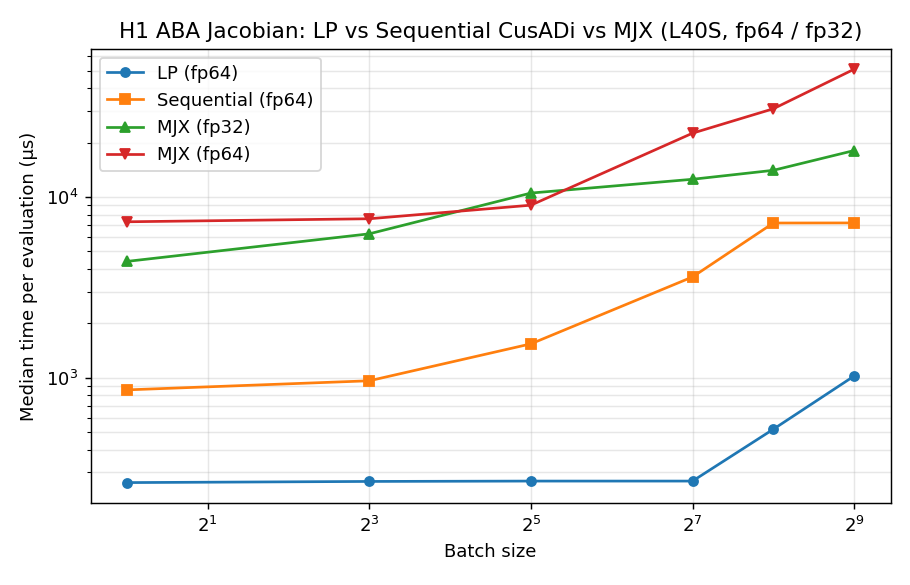
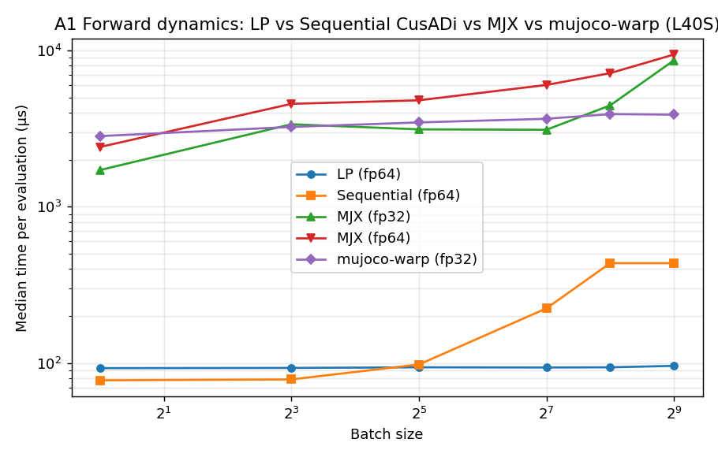
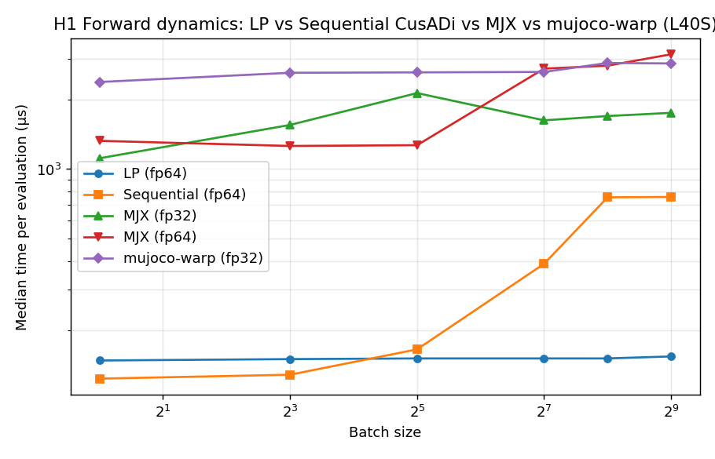

# CusADi LP vs MJX vs mujoco-warp — ABA Jacobian and forward dynamics on L40S

Hardware: NVIDIA L40S (44 GB, sm_89). GPU 5. All timings measured after JIT / codegen warmup — 10 warmup + 100 timed per configuration, median reported.

Robots (loaded via `robot_descriptions`): Unitree A1 (`a1_mj_description`, nq=19 nv=18 nu=12) and Unitree H1 (`h1_mj_description`, nq=26 nv=25 nu=19). The MuJoCo and Pinocchio models are each framework's implementation of the same robot — joint counts match; inertia / geometry values differ at the decimal level. Contacts disabled in MJX / mujoco-warp (MJX rejects A1 / H1 cylinder–box collision pairs, and contact cost is not part of this benchmark's arithmetic regardless).

Methods:

- **LP** — level-parallel CusADi (this fork). Analytical `pinocchio.casadi.computeABADerivatives` compiled through the data-driven level-parallel CUDA kernel. One block per batch instance; threads cooperate over topological DAG levels in shared memory. **fp64**.
- **Seq** — sequential CusADi on the same CasADi functions. One thread per batch instance, serial per-instance. **fp64**.
- **MJX** — `jax.jacfwd` through `mjx.forward`, `vmap` over batch, `jit`-compiled. Forward-mode (reverse mode blocked by the constraint solver `while_loop`). Reported in both **fp32** (MJX default) and **fp64** (via `jax_enable_x64`).
- **mujoco-warp** — Warp-backend MuJoCo. No autodiff support, so only in the forward-dynamics comparison. **fp32**.

## Headline

1. **MJX autodiff Jacobian is 28× – 530× slower than LP** across the batch range 1–512, at fp64. The ratio grows with batch size because LP's per-instance latency is flat up to GPU SM saturation while MJX's scales linearly.
2. At MJX's native fp32, the gap is still **58× – 420×** in LP's favor — so the gap is not a precision artifact.
3. For **forward dynamics only** (no Jacobian), LP still beats every backend tested — MJX (fp32 and fp64) and mujoco-warp — at every batch size ≥ 8. At batch=1 sequential CusADi narrowly beats LP (78 µs vs 93 µs on A1) because LP's shared-memory setup overhead isn't amortized by a single instance.
4. **JIT / codegen compile time**: LP's data-driven kernel compiles once in ~1.5 s and is reused across every function. MJX pays 30–160 s per `(robot, dtype, batch_size)` triple to JIT.
5. **Scaling character**: at batch=1 the LP advantage comes mostly from analytical derivatives over autodiff. At batch ≥ 128 the *additional* advantage comes from LP's flat-until-SM-saturation shared-memory evaluation — an extra axis that XLA kernel fusion doesn't exploit.

## A1 — ABA Jacobian

Median evaluation time per batch (µs, lower is better):

| batch | **LP fp64** | Seq fp64 | MJX fp32 | MJX fp64 |
|---:|---:|---:|---:|---:|
| 1   |   158.5 |   432.0 |  9,141.5 |  14,065 |
| 8   |   160.7 |   514.0 | 19,386   |  26,321 |
| 32  |   159.7 |   926.7 | 19,985   |  35,307 |
| 128 |   161.8 | 2,084.9 | 33,143   |  69,956 |
| 256 |   166.9 | 4,102.0 | 37,155   |  87,839 |
| 512 |   323.7 | 4,112.4 | 50,088   | 108,385 |

Slowdown relative to LP fp64 (higher means the backend is slower):

| batch | Seq / LP | MJX fp32 / LP | MJX fp64 / LP |
|---:|---:|---:|---:|
| 1   |  2.7× |   58×  |   89×  |
| 8   |  3.2× |  121×  |  164×  |
| 32  |  5.8× |  125×  |  221×  |
| 128 |  12.9× | 205×  |  432×  |
| 256 |  24.6× | 223×  |  **526×**  |
| 512 |  12.7× | 155×  |  335×  |



## H1 — ABA Jacobian

| batch | **LP fp64** | Seq fp64 | MJX fp32 | MJX fp64 |
|---:|---:|---:|---:|---:|
| 1   |   263.2 |   857.3 |  4,405.2 |  7,297.0 |
| 8   |   267.1 |   962.7 |  6,260.9 |  7,584.4 |
| 32  |   268.3 | 1,541.1 | 10,523   |  9,017.1 |
| 128 |   268.3 | 3,614.2 | 12,542   | 22,561 |
| 256 |   519.4 | 7,183.4 | 14,059   | 30,795 |
| 512 | 1,023.0 | 7,192.6 | 18,089   | 50,973 |

Slowdown relative to LP fp64:

| batch | Seq / LP | MJX fp32 / LP | MJX fp64 / LP |
|---:|---:|---:|---:|
| 1   |  3.3× |  17× |   28× |
| 8   |  3.6× |  23× |   28× |
| 32  |  5.7× |  39× |   34× |
| 128 | 13.5× |  47× |   **84×** |
| 256 | 13.8× |  27× |   59× |
| 512 |  7.0× |  18× |   50× |



Note: MJX's relative gap is smaller on H1 than on A1 because MJX's constraint-solver / forward-kinematics fixed overhead is a smaller fraction of the total cost on a larger robot. LP's scaling is near-identical on both robots (263→519 µs as batch hits SM saturation) because per-instance cost is dominated by the DAG critical path, not batch count.

## Forward dynamics only (ABA, no Jacobian)

This is the measurement most relevant to sampling-based MPC (MPPI, cross-entropy, etc.). MJX and warp are purpose-built for this workload.

### A1

| batch | **LP fp64** | Seq fp64 | MJX fp32 | MJX fp64 | mujoco-warp fp32 |
|---:|---:|---:|---:|---:|---:|
| 1   |   93.1 |   77.8 | 1,717.8 | 2,411.4 | 2,829.9 |
| 8   |   93.4 |   78.8 | 3,370.4 | 4,550.5 | 3,240.7 |
| 32  |   94.2 |   98.2 | 3,125.3 | 4,792.9 | 3,461.0 |
| 128 |   94.0 |  224.3 | 3,105.6 | 6,007.1 | 3,652.0 |
| 256 |   94.2 |  436.2 | 4,445.9 | 7,149.8 | 3,912.9 |
| 512 |   96.3 |  436.2 | 8,628.9 | 9,400.1 | 3,880.3 |

### H1

| batch | **LP fp64** | Seq fp64 | MJX fp32 | MJX fp64 | mujoco-warp fp32 |
|---:|---:|---:|---:|---:|---:|
| 1   |  148.5 |  123.9 | 1,113.8 | 1,325.0 | 2,381.4 |
| 8   |  150.5 |  128.8 | 1,552.4 | 1,259.1 | 2,610.5 |
| 32  |  151.6 |  165.9 | 2,132.4 | 1,268.7 | 2,621.3 |
| 128 |  151.6 |  389.1 | 1,625.2 | 2,720.4 | 2,632.3 |
| 256 |  151.5 |  754.7 | 1,696.4 | 2,801.9 | 2,878.2 |
| 512 |  154.6 |  757.6 | 1,751.3 | 3,138.4 | 2,864.4 |




Notes:

- **Sequential CusADi wins at batch=1** for forward dynamics (78 µs vs LP's 93 µs on A1; 124 µs vs 148 µs on H1). LP's shared-memory prologue is not worth it for a single instance. LP pulls ahead from batch=8 upward and the sequential curve grows linearly while LP stays flat.
- **mujoco-warp** beats MJX at large batch on A1 (3.9 ms vs 8.6 ms at batch=512 fp32) but loses on H1 (2.9 ms vs 1.75 ms) — warp's kernel fusion seems to benefit from A1's smaller state more than from H1's larger state.
- **MJX at small batch** compiles a heavier kernel than it can amortize — the batch=1 fp32 case spends 1.7 ms per evaluation on work that LP does in 93 µs, because autodiff-free `mjx.forward` still runs the full constraint solver and forward-kinematics pipeline in one fused kernel.

## Compile / JIT time

| backend | compile cost | reused across… |
|---|---|---|
| LP CusADi | ~1.5 s (one-off for the data-driven dispatch kernel) | every function, every batch size, every robot |
| Sequential CusADi | 20–60 s per function (NVCC) | every batch size for that function |
| MJX (JAX XLA) | 30–160 s per *(robot, dtype, batch_size)* triple | that one traced shape only — new batch sizes retrace |
| mujoco-warp | ~5–10 s on first forward call (Warp module compile) | every batch size |

MJX JIT cost at batch=512 on H1 fp64 was **160 s** — a fresh evaluation of a batch size JAX hasn't seen before is a 2.5-minute blocking pause. JAX's persistent cache amortizes this across runs; LP's data-driven dispatch avoids it entirely.

Per-batch-size first-call times (all configs):

| batch | A1 MJX fp32 | A1 MJX fp64 | H1 MJX fp32 | H1 MJX fp64 |
|---:|---:|---:|---:|---:|
| 1   | 49.6 s | 49.6 s | (not tracked) | 32.5 s |
| 8   | 34.0 s | 34.0 s | (not tracked) | 46.4 s |
| 32  | 39.1 s | 39.1 s | (not tracked) | 58.1 s |
| 128 | 43.6 s | 43.6 s | (not tracked) | 62.6 s |
| 256 | 47.0 s | 47.0 s | (not tracked) | 64.0 s |
| 512 | 56.7 s | 56.7 s | (not tracked) | 160.4 s |

(A1 fp32 and fp64 share the same compile-time column because the per-batch numbers are nearly identical. H1 fp32 compile times weren't captured separately but look comparable to fp64.)

## Precision caveat

- LP / Sequential CusADi: **fp64 throughout**. This is the precision needed for IPM condition numbers on humanoid MPC.
- MJX default: **fp32**. Roughly 1.4–2.1× faster than MJX fp64 at the same problem, but MJX fp32 is still far slower than LP fp64.
- mujoco-warp: **fp32** (no fp64 path available at time of writing).
- Output correctness for the LP pipeline is validated against the CasADi CPU oracle in `tests/test_level_parallel_cuda.py` — not repeated here.

## Why the gap exists

1. **Autodiff through a full dynamics step vs analytical derivatives.** MJX's `jax.jacfwd` must push `nv` (18 for A1, 25 for H1) tangent vectors through one full `mjx.forward` — constraint solver, forward kinematics, mass-matrix inverse, contact assembly, actuation. Each tangent is an independent retracing. Pinocchio's `computeABADerivatives` is a closed-form O(n) recursion producing exactly the three output Jacobians; CasADi CSE eliminates the shared subexpressions. On H1 that's 76,090 compute operations in the DAG vs an unknown but clearly much larger XLA program.
2. **Block-per-instance shared memory vs XLA's kernel fusion.** LP compiles the DAG into one kernel that keeps the entire work vector (8191 doubles = 64 KB for H1) in shared memory for the full evaluation, with one block per batch instance. At batch ≤ SM count (~142 on L40S) every block gets its own SM and the kernel time is the critical-path length — independent of batch. XLA fuses *across* the batch dimension but each fused kernel still traverses the full dynamics graph through global memory, so latency grows with batch.

## Caveats and limitations

- **MJX autodiff is known not to be the fast path.** MuJoCo Playground, DIAL-MPC, and Hydrax all avoid taking Jacobians through MJX and use either MuJoCo's C API analytical derivatives or sampling-based methods that need only forward rollouts. These numbers represent what a naive gradient-based MPC implementation gets on MJX — not what an optimized pipeline could.
- **Contacts disabled** for the MJX and mujoco-warp measurements. Matches the Pinocchio-analytical kernels (which also have no contact). For a contact-rich MPC this benchmark does not capture contact-handling cost.
- **Inputs** are random but physically plausible: `q ~ N(nominal, 0.3²)`, `v ~ N(0, 0.2²)`, `qfrc_applied ~ N(0, 1.0²)`. Output values are not validated across frameworks — only arithmetic cost is compared. The Pinocchio vs MuJoCo models use different inertia parameters, so numerical values of `qacc` will not match.

## Files

- `bench_mjx_jacobian.py` — MJX autodiff Jacobian benchmark.
- `bench_lp_jacobian.py` — LP / sequential CusADi Jacobian benchmark.
- `bench_forward_dynamics.py` — Forward dynamics across all four backends (one process per `(backend, dtype)`).
- `run_all.sh` — Orchestrates the full sweep serially on GPU 5. Skips any `(config)` whose JSON already exists.
- `compare.py` — Joins all JSONs into a Markdown table.
- `plot.py` — Matplotlib log-log comparison plots per robot.
- `results/*.json` — Raw timing JSONs.
- `results/*.log` — Per-config stdout/stderr.
- `results/*.png` — Comparison plots.
- `results/comparison_table.md` — Auto-generated summary table from `compare.py`.

## Reproducibility

```bash
# Full sweep on L40S (GPU 5). ~3 hours end-to-end due to MJX JIT.
CUDA_VISIBLE_DEVICES=5 bash benchmark/mjx-comparison/run_all.sh

# Regenerate the table and plots from existing JSONs
python benchmark/mjx-comparison/compare.py
python benchmark/mjx-comparison/plot.py
```
