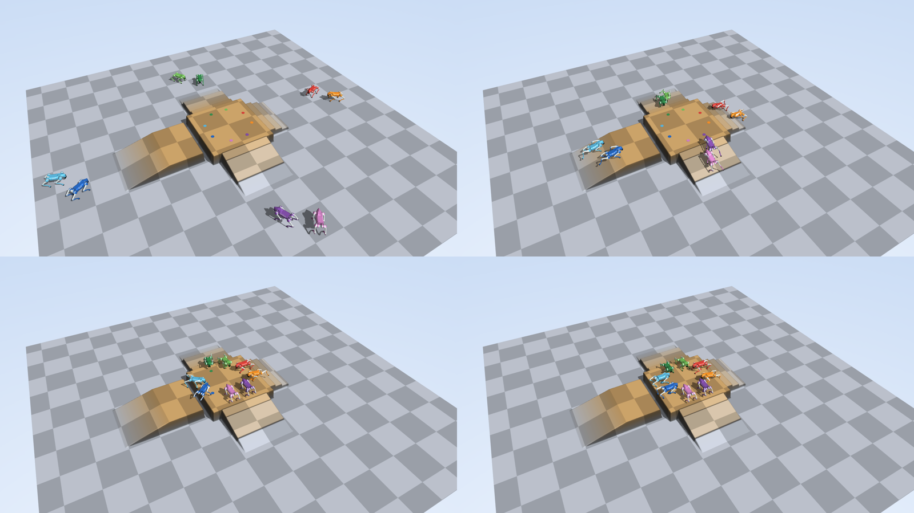
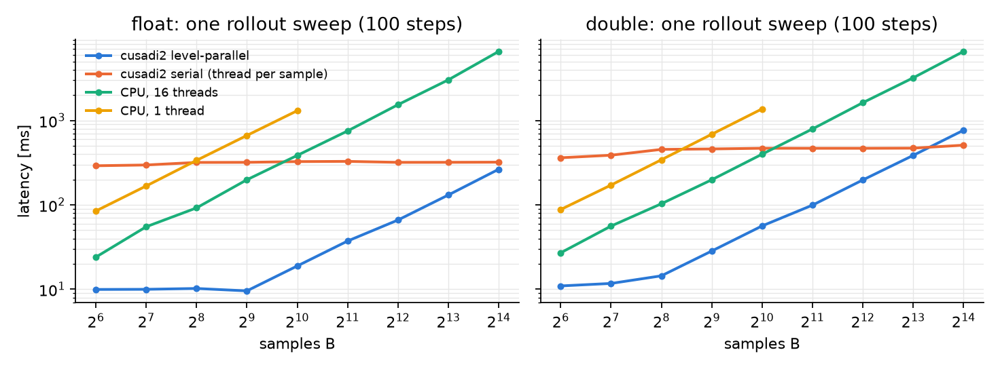

# Go2 parkour with MPPI on cusadi2

Eight Unitree Go2 robots climb onto a raised platform from four sides (stairs, a tall box, a gap, a
ramp) under sampling-based MPC: every control step, each robot's controller rolls out K perturbed
plans through a full-body model with penalty contact, weights them by cost, and executes the mean.
The rollouts are one CasADi function (dynamics, contact, PD control and the running cost together),
evaluated by cusadi2 over the batch of 8 x K samples; the sampling, weighting and plant stepping are
small CUDA kernels in the same driver, and one control step replays as one CUDA graph. The formulation
is written out in `FORMULATION.md`.



`results/course.mp4` (16 s at the 50 Hz control rate; seed 3 of the four below).

## The course

One analytic height function (`course.py`), a 2.4 m square summit 0.4 m high reached from four sides:

| side | approach | robots |
|---|---|---|
| east | 4 stairs of 0.1 m (0.3 m treads) | 0, 1 |
| north | a 0.2 m box, then a 0.1 m step | 2, 3 |
| west | a 15 deg ramp to an outer platform, then a 0.2 m gap | 4, 5 |
| south | a 14 deg ramp | 6, 7 |

Every robot starts 3.5-5.9 m out, off the centre line and with a 0.3-0.6 rad heading error, and has its
own parking spot on the summit (robots do not collide with each other). The task is the goal only: the
cost commands a speed toward the spot and a final heading; how to cross what is in between is up to
the sampling, with a trot-clock foot-clearance prior (FORMULATION.md, section 4).

**Shrunk from the plan.** The north side was meant to be a 0.4 m step split into two 0.2 m rises and
the gap 0.4 m wide. A first 0.2 m rise is climbed reliably; a second 0.2 m rise from the top of the box
never was (0 of 8 replicas at K = 1024, 4096, with 8 annealing iterations, with the body-height and
pitch references anticipating the riser, or with the foot-height error saturated), a single 0.3 m rise
is not attempted, and a 0.25 m one succeeds rarely. The second rise is now 0.1 m. The 0.4 m gap is
never crossed by the trot (the rear feet land in it); 0.3 m is crossed by 0 of 8, 0.2 m by 7 of 8
(with the feet-under-hips weight lowered and a longer swing phase), and 0.15 m is worse again because a
foot wedges between the walls. The gap is 0.2 m.

## Closed-loop results (RTX 4080, fp32, K = 1024, 4 iterations, 0.4 s horizon)

Four seeds of the same 16 s run; pass = parked within 0.15 m of the spot, base z-axis within 35 deg of
vertical over the last second, base centre never below 5 cm above the terrain under it.

| robot | approach | parked (4 seeds) | arrival, seed 3 [s] | min clearance [m] | max tilt [deg] |
|---|---|---|---|---|---|
| 0 | stairs | 3/4 | 8.7 | 0.058 | 25 |
| 1 | stairs | 4/4 | 10.6 | 0.100 | 35 |
| 2 | box + step | 3/4 | 12.1 | 0.064 | 28 |
| 3 | box + step | 2/4 | 10.1 | 0.062 | 29 |
| 4 | ramp + gap | 3/4 | 13.6 | 0.155 | 20 |
| 5 | ramp + gap | 3/4 | 13.4 | 0.167 | 21 |
| 6 | ramp | 4/4 | 6.8 | 0.238 | 19 |
| 7 | ramp | 4/4 | 8.0 | 0.238 | 20 |

Seeds 1-4 park 7, 6, 8 and 5 of the 8 robots (`results/course_seed*.csv`). The failures are stalls
(trotting in place below a riser or straddling the gap), one flip on the stairs, and one slow box
climb that scraped the belly. The controller is not deterministic across seeds because the sampling
noise differs; the model is.

Ablation, seed 3: 1 sampling iteration (vanilla MPPI) parks 2 of 8 (the ramps), 2 iterations 6 of 8,
4 iterations 8 of 8 (`results/course_iters*.csv`).

fp64 cross-check: the same seed in the double build parks 6 of 8 (one stair flip, one gap stall;
`results/course_fp64.csv`) at 1599 ms per control step, 3.0x the fp32 time. The two precisions see
the same noise but their rollouts diverge chaotically within a few control steps, so this is a
check that fp32 is good enough for the task, not a trajectory comparison; the benchmark checksums
(`results/bench.csv`) show the fp32 and fp64 kernels and the CPU agree on identical rollouts.

## Latency

The step function has 16,841 instructions in 186 levels (2,739 live slots, 11 KB of shared memory in
fp32). A control step is 4 iterations x 100 chained evaluations over 8 x 1024 samples plus the MPPI
kernels: **530 ms** (p99 531 ms) at this size, 0.038x real time. Real time (20 ms) is reached only
for small problems (`results/realtime.csv`, one robot, median control step):

| iterations | K = 64 | 256 | 1024 |
|---|---|---|---|
| 1 | 10.5 ms | 9.7 ms | 19.4 ms |
| 2 | 18.3 | 18.9 | 38.3 |
| 4 | 36.2 | 37.3 | 76.2 |

Below about B = 512 samples the step function is latency-bound at roughly 90 us per evaluation (186
levels, one block barrier each), so the fused five-step plan does not help (35 vs 36 ms) and the
sample count is free up to there: 8 robots x 64 samples cost the same as 1 x 512.

### Rollout sweep against the sample count (`bench.py`)



One sweep = 100 chained evaluations of the same function on the same inputs (checksums agree):
cusadi2 level-parallel, cusadi2 serial mode (one thread per sample walking CasADi's instruction
stream, the original cusadi execution model) and CasADi's generated C on the CPU (gcc -O3
-march=native, OpenMP over samples, 16 cores).

| B | level fp32 | serial fp32 | CPU 16 thr fp32 | level fp64 | serial fp64 | CPU 16 thr fp64 |
|---|---|---|---|---|---|---|
| 64 | 9.9 ms | 290 | 24 | 11.0 | 361 | 27 |
| 1024 | 18.9 | 325 | 385 | 56 | 468 | 398 |
| 16384 | 264 | 320 | 6569 | 765 | 509 | 6563 |

Serial mode is flat in B until the GPU is full (one thread walks 1.7 M instructions per sweep, about
0.2 us each), so at B = 16384 it matches level mode's throughput within 1.2x in fp32 and beats it in
fp64 (765 vs 509 ms); the level kernel wins by 30x at the sample counts the controller actually uses.
Against 16 CPU threads the level kernel is 2.4x faster at B = 64 and 20-25x from B = 1024 up.

## Files

- `course.py`: the course as one analytic height function `h(x, y)` and the eight robots (start pose,
  parking spot). `GO2_COURSE="GAP=0.3"` overrides a size for experiments.
- `go2_model.py`: the step function (Pinocchio ABA of the Menagerie `go2.xml`, penalty contacts at
  13 points, PD from knot interpolation, the cost terms) and `PARAMS`, the tunable parameters that are
  inputs of the function.
- `build.py`: writes the plans (`build/plans`, one and five fused physics steps, float and double),
  the kernel source, `meta.{json,txt}`, the knot limits and benchmark inputs, and compiles the drivers.
- `mppi_rollout.cu`: the closed-loop driver (`<build> <run> [K= iters= steps= temp= sigma= anneal= hfac=
  seed= fused= graph=]`), logging the plant state, the plan and the sample statistics per control step.
- `gen_run.py`: writes a run directory (`flat`, `sweep`, `course`, or one approach `east|north|west|south`
  with eight copies of one robot) with optional per-robot parameter overrides (`w_foot=3,5,...`), the
  tuning loop used here.
- `report.py`: pass/fail per robot (parked within 0.15 m, upright, never fallen) and the latency.
- `render.py`: MuJoCo render (EGL) at the control rate; `TRACK=<robot>` follows one robot.
- `mppi_bench.cu`, `cpu_bench.py`, `bench.py`: the rollout-sweep latency benchmark and its plot.
- `results/`: the closed-loop video and contact sheet, the per-robot report, the benchmark CSV and plot.

## Reproduce

```bash
conda activate cusadi2                       # casadi, pinocchio (with casadi bindings), mujoco, cuda-toolkit
cd examples/go2_mppi
python build.py                              # plans + nvcc, ~1 min
python gen_run.py build/run_course course
./build/mppi_rollout_f32 build build/run_course K=1024 steps=800
python report.py build build/run_course results/course_report.csv
MUJOCO_GL=egl python render.py build build/run_course results/course course
python bench.py build                        # results/bench.csv, results/bench_latency.png
```
